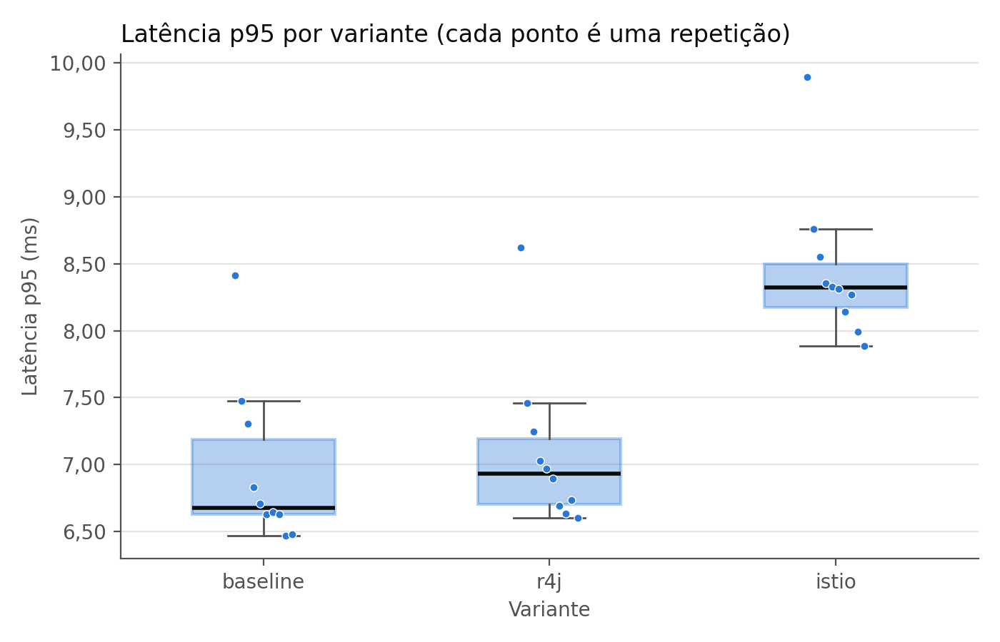
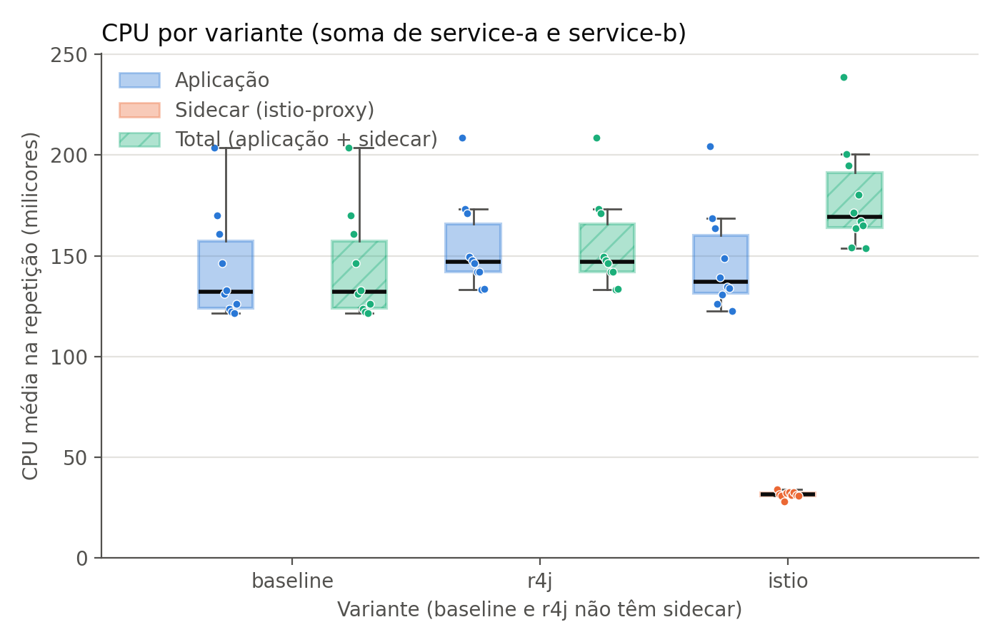

# Resultados do experimento Istio × Resilience4j

Gerado por `analise.py` em 2026-10-28 20:59.

> **Importante:** o cenário não tem falhas, então o retry e o circuit breaker nunca são acionados. Os números medem **o custo de ter a resiliência configurada** (o sidecar no caminho × a biblioteca dentro da aplicação), e não a resiliência em ação.

## Condições da execução

| Variante | Repetições | Duração (s) | Taxa (req/s) | Menor taxa de sucesso | Iterações descartadas (soma) |
|---|---|---|---|---|---|
| baseline | 10 | 90 | 20 | 100,00% | 0 |
| r4j | 10 | 90 | 20 | 100,00% | 0 |
| istio | 10 | 90 | 20 | 100,00% | 0 |

CPU e memória: média das amostras do `kubectl top` (a cada 15 s), descartando os primeiros 30 s de cada repetição.

## Medianas por variante

Mediana das repetições. CPU em milicores (1000 = 1 núcleo); memória em MiB. "Total" = aplicação + sidecar, somando service-a e service-b.

| Medida | baseline | r4j | istio |
|---|---|---|---|
| Latência p50 (ms) | 6,32 | 6,45 | 7,70 |
| Latência p95 (ms) | 6,68 | 6,93 | 8,32 |
| CPU aplicação | 132,1 | 146,9 | 137,0 |
| CPU sidecar | 0,0 | 0,0 | 31,6 |
| CPU total | 132,1 | 146,9 | 169,4 |
| Memória aplicação | 419,7 | 509,4 | 444,0 |
| Memória sidecar | 0,0 | 0,0 | 49,1 |
| Memória total | 419,7 | 509,4 | 494,7 |

## Testes de hipótese (Istio × Resilience4j)

Mann-Whitney U unilateral (H1: Istio > Resilience4j), α = 0,05 com correção de Bonferroni para 3 hipóteses: α ajustado = 0,05 / 3 ≈ 0,0167. A correção é usada porque, ao fazer vários testes, aumenta a chance de achar uma diferença "significativa" só por acaso; dividir o α pelo número de testes mantém essa chance total em no máximo 5%. Tamanho de efeito: δ de Cliff (Romano et al., 2006).

| Hipótese | Medida | Mediana r4j | Mediana istio | Diferença | Diferença (%) | p-valor | δ de Cliff | Efeito | Significativa? |
|---|---|---|---|---|---|---|---|---|---|
| H1 | latência p95 (ms) | 6,93 | 8,32 | 1,39 | 20,1% | 0,0009 | 0,84 | grande | sim |
| H2 | CPU total (milicores) | 146,90 | 169,40 | 22,50 | 15,3% | 0,0128 | 0,60 | grande | sim |
| H3 | memória total (MiB) | 509,40 | 494,70 | -14,70 | -2,9% | 0,9997 | -0,91 | grande | não |

- **H1.** O Istio aumentou a latência p95 em 1,39 ms (20,1%) em relação ao Resilience4j. A diferença é estatisticamente significativa (p = 0,0009; α ajustado = 0,0167) e o efeito é grande (δ de Cliff = 0,84). Rejeita-se H0.
- **H2.** O Istio aumentou a CPU total em 22,50 milicores (15,3%) em relação ao Resilience4j. A diferença é estatisticamente significativa (p = 0,0128; α ajustado = 0,0167) e o efeito é grande (δ de Cliff = 0,60). Rejeita-se H0.
- **H3.** O Istio reduziu a memória total em 14,70 MiB (2,9%) em relação ao Resilience4j. A diferença não é estatisticamente significativa (p = 0,9997; α ajustado = 0,0167) e o efeito é grande (δ de Cliff = -0,91). Não se rejeita H0.

## Custo em relação ao baseline (descritivo, sem teste)

Diferença entre as medianas de cada abordagem e as do baseline (sem resiliência e sem sidecar).

| Medida | r4j − baseline | istio − baseline |
|---|---|---|
| Latência p95 | 0,25 ms (3,8%) | 1,64 ms (24,6%) |
| CPU total | 14,80 milicores (11,2%) | 37,30 milicores (28,2%) |
| Memória total | 89,70 MiB (21,4%) | 75,00 MiB (17,9%) |

## Plano de controle do Istio (istiod), descritivo

O `istiod` ficou instalado durante as três variantes, mas só atende sidecars na variante istio. É um custo fixo, compartilhado por todo o mesh e fora do caminho da requisição; por isso não entra no "total" das hipóteses.

| Variante | CPU istiod (milicores) | Memória istiod (MiB) |
|---|---|---|
| baseline | 1,3 | 27,7 |
| r4j | 1,4 | 27,0 |
| istio | 1,4 | 29,0 |

## Gráficos

## Limitações

- **Ambiente local:** um cluster kind com um único nó, num notebook (Docker Desktop no Windows/WSL2). Outros processos da máquina podem interferir, e os números absolutos não valem para um cluster de produção.
- **Uma versão de cada ferramenta:** Istio 1.24.2 (já fora do período de suporte), Kubernetes 1.31, Spring Boot 3.5.16 e Resilience4j 2.4.0.
- **Aplicação sintética:** dois serviços com 5 ms de CPU por requisição, a 20 req/s.
- **Cenário sem falhas:** mede o custo de ter a resiliência configurada, não a resiliência em ação (retry e circuit breaker nunca são acionados).
- **mTLS:** o mTLS padrão do Istio entre os sidecars está incluído no custo do sidecar.
- **Uma réplica por serviço.**
- **Repetições no mesmo deploy:** as repetições de uma variante rodam em sequência, sem reiniciar os pods; por isso não são totalmente independentes.
- **Medição de recursos:** o `kubectl top` (metrics-server) tem resolução de 15 s e responde com atraso; as amostras são médias aproximadas, não medidas exatas por requisição.
- **Recursos do sidecar:** o `istio-proxy` usa os `requests`/`limits` padrão do Istio, diferentes dos da aplicação.

## Dados por repetição

| Variante | Rep. | p50 (ms) | p95 (ms) | CPU app | CPU sidecar | CPU total | Mem. app | Mem. sidecar | Mem. total |
|---|---|---|---|---|---|---|---|---|---|
| baseline | 1 | 7,33 | 8,41 | 203,6 | 0,0 | 203,6 | 409,0 | 0,0 | 409,0 |
| baseline | 2 | 6,80 | 7,48 | 170,0 | 0,0 | 170,0 | 413,6 | 0,0 | 413,6 |
| baseline | 3 | 6,70 | 7,31 | 161,0 | 0,0 | 161,0 | 415,0 | 0,0 | 415,0 |
| baseline | 4 | 6,43 | 6,83 | 146,2 | 0,0 | 146,2 | 417,8 | 0,0 | 417,8 |
| baseline | 5 | 6,34 | 6,71 | 131,2 | 0,0 | 131,2 | 418,4 | 0,0 | 418,4 |
| baseline | 6 | 6,30 | 6,63 | 133,0 | 0,0 | 133,0 | 421,8 | 0,0 | 421,8 |
| baseline | 7 | 6,26 | 6,64 | 123,6 | 0,0 | 123,6 | 421,0 | 0,0 | 421,0 |
| baseline | 8 | 6,22 | 6,63 | 122,2 | 0,0 | 122,2 | 421,6 | 0,0 | 421,6 |
| baseline | 9 | 6,13 | 6,47 | 121,4 | 0,0 | 121,4 | 422,2 | 0,0 | 422,2 |
| baseline | 10 | 6,12 | 6,48 | 126,0 | 0,0 | 126,0 | 423,4 | 0,0 | 423,4 |
| r4j | 1 | 7,52 | 8,62 | 208,6 | 0,0 | 208,6 | 496,0 | 0,0 | 496,0 |
| r4j | 2 | 6,93 | 7,46 | 173,2 | 0,0 | 173,2 | 501,6 | 0,0 | 501,6 |
| r4j | 3 | 6,75 | 7,25 | 171,2 | 0,0 | 171,2 | 504,4 | 0,0 | 504,4 |
| r4j | 4 | 6,51 | 7,03 | 149,4 | 0,0 | 149,4 | 507,0 | 0,0 | 507,0 |
| r4j | 5 | 6,46 | 6,97 | 147,6 | 0,0 | 147,6 | 508,6 | 0,0 | 508,6 |
| r4j | 6 | 6,43 | 6,89 | 146,2 | 0,0 | 146,2 | 515,0 | 0,0 | 515,0 |
| r4j | 7 | 6,33 | 6,69 | 142,2 | 0,0 | 142,2 | 510,2 | 0,0 | 510,2 |
| r4j | 8 | 6,27 | 6,64 | 142,2 | 0,0 | 142,2 | 510,8 | 0,0 | 510,8 |
| r4j | 9 | 6,26 | 6,73 | 133,4 | 0,0 | 133,4 | 511,6 | 0,0 | 511,6 |
| r4j | 10 | 6,21 | 6,60 | 133,6 | 0,0 | 133,6 | 512,2 | 0,0 | 512,2 |
| istio | 1 | 8,73 | 9,89 | 204,4 | 34,2 | 238,6 | 433,2 | 57,2 | 490,4 |
| istio | 2 | 8,16 | 8,76 | 168,8 | 31,8 | 200,6 | 439,0 | 58,0 | 497,0 |
| istio | 3 | 7,98 | 8,55 | 163,8 | 31,0 | 194,8 | 441,8 | 50,6 | 492,4 |
| istio | 4 | 7,76 | 8,36 | 126,2 | 28,0 | 154,2 | 443,0 | 48,8 | 491,8 |
| istio | 5 | 7,70 | 8,33 | 139,4 | 32,2 | 171,6 | 443,8 | 49,0 | 492,8 |
| istio | 6 | 7,69 | 8,31 | 130,8 | 32,8 | 163,6 | 444,2 | 49,2 | 493,4 |
| istio | 7 | 7,61 | 8,14 | 148,8 | 31,4 | 180,2 | 447,0 | 49,0 | 496,0 |
| istio | 8 | 7,59 | 8,27 | 134,6 | 32,6 | 167,2 | 447,2 | 49,2 | 496,4 |
| istio | 9 | 7,47 | 7,99 | 134,0 | 31,2 | 165,2 | 447,2 | 49,0 | 496,2 |
| istio | 10 | 7,40 | 7,88 | 122,8 | 31,0 | 153,8 | 448,2 | 49,0 | 497,2 |
